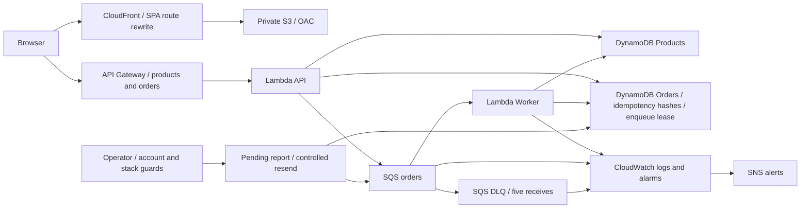

# Architecture baseline — review draft, 2026-11-20

Status: **Pending owner/architect approval**. This source-derived diagram does not substitute for missing approved v1.1 artwork.

IAM scopes runtime access. CloudFormation manages application resources; deployment artifacts use a separate private S3 bucket. No additional application service is introduced by the CloudFront Function.

The order API accepts `items[]` and the legacy single-product form. POST requires a canonical UUIDv4 idempotency key. GET order requires the original key as an anonymous bearer token. Product quantities follow the active campaign policy. See the [F10 contract](../features/F10-atomic-cart-checkout.md).

Conditional order creation, a 30-second enqueue lease and a three-send bound protect retries. A single transaction commits stock decrements for every item and confirms the order. Uncertain sends remain UNKNOWN. Technical worker failures preserve PENDING for retry. The manual overdue threshold defaults to 300 seconds and the business SLA remains pending.

Review decisions outstanding: approve this baseline; agree UNKNOWN semantics and overdue SLA; choose Workshop host; authorize live failure/cleanup rehearsal. Admin/Monitoring simulated. Current AWS deployment not verified.
