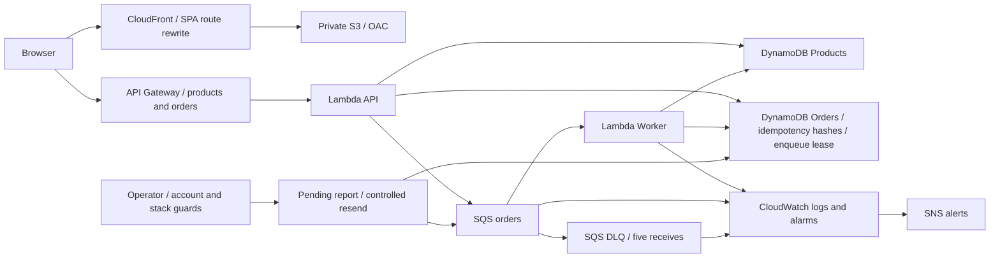

# Architecture baseline — review draft, 2026-11-20

Status: **Pending owner/architect approval**. This source-derived diagram does not substitute for missing approved v1.1 artwork.

IAM scopes runtime access. CloudFormation manages application resources; deployment artifacts use a separate private S3 bucket. No additional application service is introduced by the CloudFront Function.

API: GET /products, GET /products/{productId}, POST /orders, GET /orders/{orderId}. POST requires canonical UUIDv4 idempotency key and quantity=1; GET order requires original key as bearer token. Preserve anonymous capability semantics; do not claim account authentication.

Conditional order creation, 30-second enqueue lease, three-send bound, duplicate-safe stock/order transaction. Send exceptions remain UNKNOWN conservatively; distinguishing proven rejection from ambiguous transport failure requires explicit contract agreement. No automatic FAILED transition or pending scheduler. Manual overdue threshold defaults to 300s operationally; business SLA remains pending.

Review decisions outstanding: approve this baseline; agree UNKNOWN semantics and overdue SLA; choose Workshop host; authorize live failure/cleanup rehearsal. Admin/Monitoring simulated. Current AWS deployment not verified.
