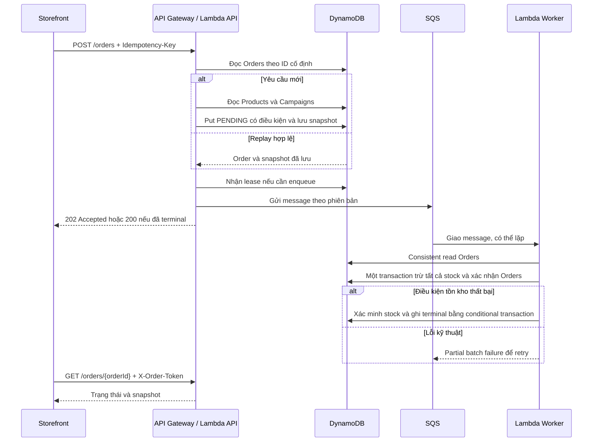

# F10 — Giỏ hàng nhiều sản phẩm và checkout nguyên tử

Thiết kế triển khai cho FLASHRUSH Lab. Trạng thái phê duyệt kiến trúc tiếp tục được theo dõi trong [bản kiến trúc hiện hành](../architecture/baseline.md).

## Trải nghiệm mua hàng

- Trang danh sách và trang chi tiết hỗ trợ thêm sản phẩm vào giỏ. Mua ngay giữ đường dẫn `/checkout?productId=…&quantity=…&color=…` và hoạt động độc lập.
- `/cart` hiển thị hình, tên, lựa chọn màu, đơn giá, số lượng, thành tiền, tồn kho và tổng dự kiến. Người mua có thể đổi số lượng, xóa từng sản phẩm hoặc xóa giỏ.
- Khi mở giỏ và trước khi gửi checkout, frontend lấy lại sản phẩm và chiến dịch. Giá mới được hiển thị để người dùng xem lại. Sản phẩm hết hàng, đã bị xóa, hết phiên, có màu không còn hợp lệ hoặc vượt giới hạn vẫn hiện trong giỏ với lý do. Checkout gửi toàn bộ giỏ hợp lệ một lần.
- Processing, Result và History hiển thị các dòng sản phẩm, tổng số lượng, giá đã chốt và thời gian. Lịch sử tìm kiếm theo tên hoặc mã của bất kỳ sản phẩm nào trong đơn.

## Dữ liệu trình duyệt

Giỏ hàng sử dụng `flashrush.cart.v1` trong `localStorage`. Mỗi `productId` có một dòng cùng `name`, `image`, `quantity`, `unitPrice`, `selectedColor?` và danh sách lần thêm. Khi chọn màu khác cho một sản phẩm đang có trong giỏ, người mua xóa dòng cũ rồi thêm lại. Màu là lựa chọn hiển thị và dùng chung tồn kho theo `productId`.

Frontend lưu `PurchaseIntent` trong `sessionStorage` trước POST, gồm khóa UUIDv4, `items[]`, nguồn checkout và ID của các lần thêm đã gửi. Lỗi mạng, phản hồi không xác định, timeout và 503 giữ nguyên intent. Phản hồi từ chối có mã xác định trước intake cho phép sửa giỏ và tạo yêu cầu khác. Đơn đã tiếp nhận được theo dõi với credential của phiên và snapshot lưu trong lịch sử local.

`CONFIRMED` loại bỏ các lần thêm đã thuộc đơn đó. Các lần thêm mới có ID riêng, kể cả khi người mua xóa rồi thêm lại cùng sản phẩm. Ghép theo `orderId` và loại bỏ theo ID cho phép chạy cleanup lại an toàn sau reload. `OUT_OF_STOCK`, `FAILED` và Mua ngay giữ giỏ hiện tại.

## API và mô hình Orders

`POST /orders` nhận `Content-Type: application/json` và `Idempotency-Key: <UUIDv4 dạng canonical>`.

```json
{"items":[{"productId":"sku-a","quantity":1},{"productId":"sku-b","quantity":1}]}
```

Request cũ `{"productId":"sku-a","quantity":1}` tiếp tục hoạt động. Requests có cả hai cấu trúc, mảng rỗng, kiểu dữ liệu sai hoặc vượt giới hạn trả `400`; sản phẩm thiếu trả `404`; điều kiện chiến dịch hoặc idempotency conflict trả `409`. Giới hạn ứng dụng là 20 mã sản phẩm, 16 KiB cho JSON request và 64 KiB cho kích thước tuần tự hóa của bản ghi Orders. Các dòng trùng được gộp và kiểm tra giới hạn chiến dịch trên tổng số lượng. Khi nhiều chiến dịch đang hoạt động cùng áp dụng một sản phẩm, mức thấp nhất được dùng.

API chụp snapshot từ Products, tính tiền VND nguyên và tạo một Orders record. Phần public của một `202 Accepted` có dạng sau.

```json
{
  "orderId":"ord_example",
  "status":"PENDING",
  "items":[
    {"productId":"sku-a","name":"Sản phẩm A","image":"/images/a.jpg","quantity":1,"unitPrice":500000,"subtotal":500000},
    {"productId":"sku-b","name":"Sản phẩm B","image":"/images/b.jpg","quantity":1,"unitPrice":300000,"subtotal":300000}
  ],
  "totalQuantity":2,
  "subtotal":800000,
  "discountAmount":0,
  "totalAmount":800000,
  "createdAt":"2026-11-25T09:00:00Z",
  "updatedAt":"2026-11-25T09:00:00Z",
  "accepted":true,
  "statusUrl":"/orders/ord_example"
}
```

`202` xác nhận tiếp nhận vào hàng đợi hoặc enqueue đã được ghi nhận. Đơn terminal trả `200` khi replay. Với `503`, frontend retry cùng khóa và payload. `GET /orders/{orderId}` yêu cầu `X-Order-Token` mang khóa gốc, trả snapshot và `confirmedAt` khi có. Lỗi giữ envelope `{error:{code,message,retryable,requestId}}`. Hash, lease, credential và correlation ID dùng trong vận hành nằm ngoài response public.

Orders giữ partition key `orderId` hiện tại, snapshot và metadata idempotency/lease. Đơn một dòng giữ `productId` và `quantity` ở cấp gốc vì có client và message v1 sử dụng chúng. Đơn cũ được đọc thành một dòng. Nếu snapshot lịch sử thiếu giá, giao diện báo chưa có dữ liệu giá.

## Luồng xử lý



- Hash sử dụng cặp `productId`, `quantity` đã chuẩn hóa và sắp theo mã. Với một dòng dùng cùng representation và namespace trước đây. Replay đọc Orders trước catalog để giữ snapshot. Một khóa với nội dung khác trả `409`.
- SQS v1.0 có `orderId`, `productId`, `quantity`, `correlationId` và `schemaVersion`. Worker vẫn hiểu dạng cũ không kèm correlation ID. v2.0 cho đơn nhiều dòng chỉ có `orderId`, `correlationId` và `schemaVersion`. Worker kiểm tra message với bản ghi và sử dụng số lượng trong Orders.
- `TransactWriteItems` ghi mỗi sản phẩm đúng một lần, với điều kiện stock đủ, và chuyển Orders từ `PENDING` sang `CONFIRMED`. Tất cả cập nhật commit cùng nhau. Một message lặp thấy đơn terminal sẽ dừng. Hai worker cùng thấy PENDING vẫn phải qua điều kiện trạng thái lúc commit. [DynamoDB transactions](https://docs.aws.amazon.com/amazondynamodb/latest/developerguide/transaction-apis.html)
- Khi lỗi điều kiện sản phẩm có nguyên nhân rõ, worker đọc stock nhất quán và dùng transaction thứ hai với `ConditionCheck` để xác nhận stock vẫn bằng giá trị thiếu hàng đã đọc. Nếu vừa restock, order tiếp tục PENDING và SQS retry. Sản phẩm bị xóa hoặc dữ liệu stock lỗi đã được xác minh có thể đưa order sang `FAILED` kèm `failureReason`. Conflict, throttling, timeout và cancellation không xác định giữ PENDING.
- Lease 30 giây và tối đa ba lần enqueue tiếp tục áp dụng. Với ACK không xác định, `scripts/ops/reconcile_pending.py` có thể gửi lại sau khi lease hết hạn. Worker trả partial batch failure và SQS tiếp tục chính sách retry/DLQ hiện có. DLQ cần đối soát order trước khi redrive.

## Chạy và kiểm thử

Chạy từ thư mục ứng dụng lồng bên trong repo, nơi có `backend` và `frontend`.

```powershell
python -m pip install -r backend/requirements-lock.txt
python -B -m unittest discover -s backend -p 'test_*.py' -v
python -B -m unittest discover -s scripts/deploy -p 'test_*.py' -v
npm ci --prefix frontend
npm test --prefix frontend
npm run build --prefix frontend
npm run dev --prefix frontend
```

Trong mock, đơn mới được xác nhận tự động sau khoảng sáu giây. Từ trang sản phẩm, thêm hai mã khác nhau, mở giỏ, tải lại trang và bấm **Đặt hàng**. Kiểm tra màn hình theo dõi, kết quả và lịch sử. Các ca hết hàng và lỗi được chạy bằng Vitest và unittest. Có thể tăng `maxQtyPerOrder` của chiến dịch demo trong Quản lý chiến dịch để thử tăng số lượng. Mock dùng giá từ giao diện để mô phỏng snapshot và giữ nguyên tồn kho catalog.

Với HTTP mode, đặt `VITE_ORDER_MODE=http` và `VITE_API_BASE_URL` trỏ vào lab đã triển khai và khởi động lại Vite. API là nguồn trạng thái và giá snapshot. Để kiểm tra riêng build HTTP, có thể dùng URL mẫu `https://example.invalid` trong process build.

| Kiểm thử | Điều kiện xác nhận |
| --- | --- |
| Backend | Validation, snapshot từ catalog, replay cùng hash, 1.0 và 2.0, token, mất ACK, restock giữa hai transaction, phân loại lỗi |
| A — 100 giỏ A+B | A=10 và B=20, 10 CONFIRMED, 90 OUT_OF_STOCK, tồn cuối A=0, B=10 |
| B — B hết hàng | A=100 và B=0, OUT_OF_STOCK, tồn cuối A=100, B=0 |
| C — A+B và B+C | A=B=C=5, năm order CONFIRMED, B=0, tồn từng SKU khớp tổng lượng bán |
| D — Retry đồng thời | Replay cùng key giữ một Orders record. SQS lặp chỉ giảm stock một lần |
| Frontend | Persist, JSON lỗi, giới hạn giỏ, giá/tồn mới, retry giữ payload, giá lịch sử, cleanup theo đơn, mock outcomes |

Moto chạy nhiều worker thread, tuần tự hóa thao tác DynamoDB của các fixture đồng thời để tránh rollback đè dữ liệu của nhau trong Moto. Để chạy cùng suite với transaction song song, khởi động DynamoDB Local ở port 8250. [DynamoDB Local](https://docs.aws.amazon.com/amazondynamodb/latest/developerguide/DynamoDBLocal.DownloadingAndRunning.html)

```powershell
java '-Djava.library.path=./DynamoDBLocal_lib' -jar DynamoDBLocal.jar -inMemory -sharedDb -port 8250
```

Từ thư mục ứng dụng, đặt `$env:F10_DYNAMODB_LOCAL = '1'` trước lệnh unittest backend. Fixture chỉ kết nối loopback bằng credential giả, tạo bảng riêng và dọn bảng sau test. SQS vẫn dùng Moto. DynamoDB Local kiểm tra cập nhật có điều kiện và invariant trên máy, với mô hình contention và throttling khác dịch vụ AWS.

Kết quả kiểm tra local ngày 25/11/2026 gồm 25/25 backend với Moto, 25/25 backend với DynamoDB Local 3.3.2, 4/4 kiểm tra triển khai và 42/42 Vitest. Build mock và HTTP đều hoàn tất. Chrome headless kiểm tra mock trên desktop và mobile 390 px, rồi kiểm tra HTTP với API fixture. Các case trình duyệt gồm reload giỏ và Processing, gửi hai lần liên tiếp, lỗi polling, lỗi gửi POST và retry cùng key/payload, đổi giá, giữ giỏ khi thiếu hàng, giữ sản phẩm thêm sau khi gửi và tìm theo sản phẩm thứ hai trong lịch sử.

## Rollout và mở rộng

1. Áp dụng CloudFormation và chờ Worker tương thích v1/v2 cập nhật trước API. Generator khai báo quan hệ phụ thuộc Worker → API trong template. Sau khi stack hoàn tất, xác nhận mapping và thử replay v1. [CloudFormation DependsOn](https://docs.aws.amazon.com/AWSCloudFormation/latest/TemplateReference/aws-attribute-dependson.html)
2. Phát hành frontend sau khi API sẵn sàng. CloudFront rewrite `/cart` sang entrypoint SPA, giữ lỗi cho đường dẫn asset. Lab cần chiến dịch đang hoạt động chứa các mã dùng để demo.
3. Bài verify live cũ tiếp tục chạy ở chế độ single. Tùy chọn `scripts/deploy/verify.py --multi-product` tạo fixture có hai mã và kiểm tra số dư từng sản phẩm. Các bước vận hành và giới hạn lab nằm ở [hướng dẫn AWS](../operations/aws-lab.md).
4. Khi rollback, giữ Worker tương thích v2 đến khi xử lý xong các message v2 trong queue/DLQ và đối soát hết PENDING v2.

Giới hạn số lượng áp dụng trên tổng theo mã sản phẩm và tái sử dụng `maxQtyPerOrder` đang có của F01. Người phụ trách F09 có thể bổ sung policy số lượng tại bước validation sau chuẩn hóa và dùng cùng policy khi tính giới hạn ở giao diện. F11 có sẵn `subtotal`, `discountAmount`, `totalAmount` cùng vị trí mở rộng trong transaction. F12 có thể lấy số lượng, dòng doanh thu và `confirmedAt` từ order xác nhận.

Giỏ chỉ lưu trong trình duyệt, quyền truy cập order giữ theo session. Màu là lựa chọn hiển thị và dùng chung tồn kho. Đợt này chỉ có checkout bất đồng bộ mô phỏng, với thanh toán và vận chuyển nằm ngoài F10. Thay đổi CloudFormation chưa được áp dụng lên AWS thật.

## Danh sách file

**File mới**

- Tài liệu `docs/features/F10-atomic-cart-checkout.md`.
- Frontend `src/contexts/CartContext.tsx`, `src/pages/CartPage.tsx`, `src/services/cartStorage.ts`, `src/services/cartStorage.test.ts`, `src/services/checkoutCatalog.ts`, `src/types/cart.ts`, `src/utils/campaign.ts`.

**File chỉnh sửa**

- Backend `backend/app.py`, `backend/test_app.py`, `backend/README.md`.
- Luồng storefront trong `frontend/src` gồm `App.tsx`, `pages/CheckoutPage.tsx`, `pages/HomePage.tsx`, `pages/OrderHistoryPage.tsx`, `pages/OrderProcessingPage.tsx`, `pages/OrderResultPage.tsx`, `pages/ProductDetailPage.tsx`, `pages/ProductListingPage.tsx`, `components/layout/Navbar.tsx`, `components/order/OrderSummary.tsx`, `components/product/ProductCard.tsx`, `components/product/ProductGrid.tsx`, `hooks/useOrderPolling.ts` và `styles/index.css`.
- Thao tác sau khi đặt trong `frontend/src/components/order/OrderResultActions.tsx`.
- Dữ liệu và adapter trong `frontend/src` gồm `services/campaignService.ts`, `services/httpOrderService.ts`, `services/httpOrderService.test.ts`, `services/mockOrderService.ts`, `services/mockOrderService.test.ts`, `services/orderStorage.ts`, `services/productService.ts` và `types/order.ts`.
- Tương thích admin demo trong `frontend/src` gồm `components/admin/AdminTables.tsx`, `pages/AdminDashboardPage.tsx`, `mocks/dashboardMockData.ts` và `services/mockDashboardService.ts`.
- Triển khai `infrastructure/templates/flashrush.json`, `scripts/deploy/deploy.py`, `scripts/deploy/test_lab.py`, `scripts/deploy/verify.py`.
- Tài liệu `README.md` ở repo root, `frontend/ORDER_HANDOVER.md`, `docs/architecture/baseline.md`, `docs/operations/aws-lab.md`, `docs/operations/cleanup-runbook.md` và `docs/requirements/system-overview.md`.
