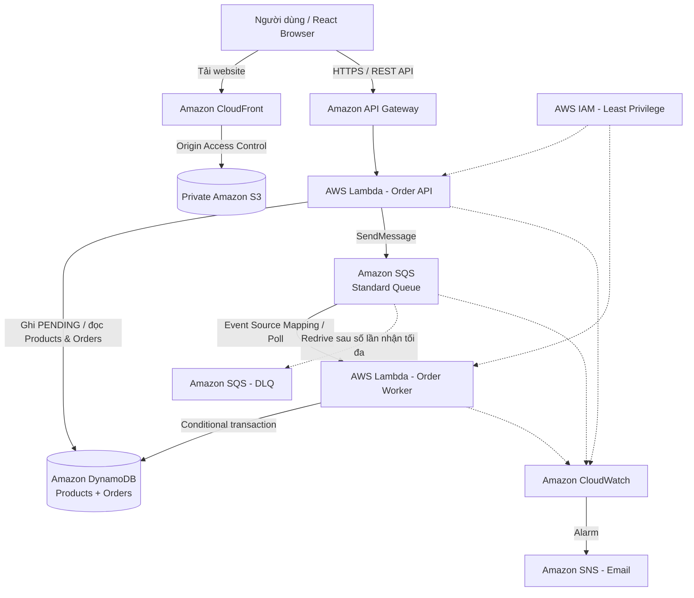

[README.md](https://github.com/user-attachments/files/35011482/README.md)
<div align="center">

# ⚡ FLASHRUSH

### Building a High-Concurrency Serverless Flash Sale System on AWS

**Ứng dụng mô phỏng Flash Sale sử dụng kiến trúc Serverless & Event-Driven, tập trung vào xử lý đơn hàng đồng thời và chống bán vượt tồn kho (overselling).**

**Trạng thái:** Đang phát triển · **Tài liệu thiết kế:** System Overview v1.1 (Revised Draft) · **Chương trình:** FCAJ Workshop

[Kiến trúc hệ thống](#-kiến-trúc-hệ-thống) · [Công nghệ](#-dịch-vụ-aws) · [Chạy demo](#-chạy-frontend-demo-local) · [Kiểm thử](#-kiểm-thử-và-tiêu-chí-nghiệm-thu) · [Jira](https://ktran6738.atlassian.net/jira/software/projects/SCRUM/boards/1)

</div>

---

## 📌 Tổng quan dự án

Trong một đợt Flash Sale, hàng trăm khách hàng có thể đồng thời đặt mua sản phẩm có số lượng giới hạn. Nếu hệ thống xử lý tồn kho theo mô hình đọc–sửa–ghi thông thường, nhiều request có thể cùng nhìn thấy số lượng còn hàng và dẫn tới **race condition / overselling**.

FLASHRUSH được thiết kế để minh họa cách phối hợp **API Gateway, AWS Lambda, Amazon SQS và DynamoDB transactions** nhằm:

- Tiếp nhận yêu cầu đặt hàng qua HTTP API và **xử lý bất đồng bộ**.
- **Không xác nhận số hàng vượt quá tồn kho thực tế**.
- Tránh xử lý trùng khi người dùng retry request hoặc SQS giao lại message.
- Cho phép người mua kiểm tra trạng thái đơn hàng.
- Giám sát lỗi, hàng đợi và xử lý sự cố bằng CloudWatch, SNS, DLQ.
- Cung cấp hướng dẫn triển khai, kiểm thử và dọn dẹp tài nguyên theo định dạng **FCAJ Workshop**.

> [!IMPORTANT]
> FLASHRUSH là **hệ thống mô phỏng phục vụ học tập/workshop**, không phải nền tảng thương mại điện tử thật. **Không có thanh toán, vận chuyển hoặc tài khoản khách hàng production.** Kiến trúc và API trong tài liệu v1.1 vẫn cần review/phê duyệt; không coi số liệu mock là kết quả chạy trên AWS.

## 🎯 Mục tiêu kỹ thuật

Bài kiểm thử trọng tâm sử dụng một sản phẩm với **10 đơn vị tồn kho ban đầu** và **100 yêu cầu mua độc lập, hợp lệ** (`quantity = 1`, mỗi yêu cầu có idempotency key riêng).

| Chỉ số | Mục tiêu kỳ vọng* |
|---|---:|
| Yêu cầu đặt hàng hợp lệ | 100 |
| Đơn được xác nhận (`CONFIRMED`) | 10 |
| Đơn hết hàng (`OUT_OF_STOCK`) | 90 |
| Tồn kho cuối | 0 |
| Overselling / trừ kho hai lần | 0 |

*Chỉ kỳ vọng đúng kết quả **10/90** khi cả 100 yêu cầu được tiếp nhận, xử lý đến trạng thái cuối và không có lỗi kỹ thuật khác. Đây **không phải kết quả benchmark đã được xác minh**.*

**Bất biến dữ liệu:**

```text
stock_after = stock_before - SUM(quantity của các order CONFIRMED duy nhất)
stock_after >= 0
```

## 🏗️ Kiến trúc hệ thống



### Luồng xử lý đơn hàng (thiết kế đề xuất)

1. Người dùng xem sản phẩm trên giao diện **React**, được phân phối qua **CloudFront + private S3**.
2. Trình duyệt gọi `POST /orders` qua **API Gateway** kèm `Idempotency-Key`.
3. **Order API Lambda** kiểm tra dữ liệu, tạo bản ghi `Orders = PENDING` có điều kiện và gửi message đến **SQS Standard**.
4. API chỉ trả **HTTP `202 Accepted`** sau khi SQS xác nhận tiếp nhận message; `202` **không có nghĩa đặt mua thành công**.
5. **Order Worker Lambda** xử lý message; **DynamoDB transaction** đồng thời trừ `Products.stock` (nếu đủ) và cập nhật `Orders: PENDING → CONFIRMED`.
6. Nếu thực sự hết hàng, Order chuyển thành `OUT_OF_STOCK`. Lỗi tạm thời được retry có kiểm soát; message không xử lý được có thể chuyển vào **DLQ**.
7. Frontend gọi `GET /orders/{orderId}` để hiển thị kết quả cuối. **CloudWatch + SNS** hỗ trợ logs, metrics và cảnh báo.

**Quy tắc nhất quán:** SQS Standard có thể giao lại message, vì vậy Worker phải idempotent. DynamoDB transaction **không bao gồm** thao tác gửi SQS; cơ chế `enqueueState`, retry và đối soát các đơn `PENDING` là phần thiết kế cần xác nhận trước khi triển khai.

> Sơ đồ có thể chỉnh sửa: [Architecture baseline (pending approval)](FLASHRUSH-Serverless-Flash-Sale/docs/architecture/baseline.md) — bản dự thảo, chưa được phê duyệt.

## ☁️ Dịch vụ AWS

| Dịch vụ | Vai trò trong FLASHRUSH |
|---|---|
| **Amazon S3** | Lưu frontend React build và static assets trong bucket private |
| **Amazon CloudFront** | CDN/HTTPS và Origin Access Control (OAC) tới S3 |
| **Amazon API Gateway** | Cung cấp HTTP APIs, CORS và giới hạn lưu lượng |
| **AWS Lambda** | Chạy Order API và Order Worker |
| **Amazon SQS** | Xử lý bất đồng bộ với Standard Queue và Dead-Letter Queue |
| **Amazon DynamoDB** | Lưu Products/Orders và cập nhật tồn kho nguyên tử có điều kiện |
| **Amazon CloudWatch** | Logs, metrics, alarms và bằng chứng vận hành |
| **Amazon SNS** | Gửi email cảnh báo từ CloudWatch Alarms |
| **AWS IAM** | Phân quyền tối thiểu giữa các tài nguyên |

**Frontend dự kiến:** React + TypeScript + Vite. **Backend dự kiến:** Lambda/Python. Cấu hình cụ thể phải đối chiếu với source code hiện hành.

## 🛒 Chức năng MVP

**Luồng khách hàng**

- Trang chủ Flash Sale, danh sách và chi tiết sản phẩm.
- Xác nhận yêu cầu mua hàng (không thanh toán thật).
- Hiển thị **đang xử lý** sau khi yêu cầu được tiếp nhận.
- Kết quả: **CONFIRMED / OUT_OF_STOCK / FAILED**.
- Theo dõi đơn bằng mã đơn và token của yêu cầu (trong demo); có thể lưu danh sách mã đơn ở trình duyệt để hiển thị *My Orders*.

**Luồng vận hành / workshop**

- Seed tồn kho mẫu, gửi request đồng thời và đối chiếu tồn kho.
- Thử request/message trùng, retry và xử lý DLQ.
- Quan sát metrics và logs, kiểm thử cảnh báo.
- Hướng dẫn setup, kiểm thử, ước tính chi phí và cleanup.

> Admin Dashboard và System Monitoring UI **có thể chạy bằng dữ liệu mô phỏng**. Khi chưa tích hợp nguồn AWS thực tế, phải hiển thị rõ nhãn **“Dữ liệu mô phỏng”**. Không coi mock dashboard là bảng điều khiển quản trị production.

## 🔌 API dự kiến (đang chờ chốt contract)

| Phương thức | Endpoint | Mục đích |
|---|---|---|
| `GET` | `/products` | Danh sách sản phẩm |
| `GET` | `/products/{productId}` | Chi tiết sản phẩm |
| `POST` | `/orders` | Tiếp nhận yêu cầu đặt hàng bất đồng bộ |
| `GET` | `/orders/{orderId}` | Tra cứu trạng thái đơn hàng |

Ví dụ body tạo đơn:

```json
{
  "productId": "SKU-001",
  "quantity": 1
}
```

`POST /orders` yêu cầu header `Idempotency-Key` (UUIDv4). API `GET /orders/{orderId}` dự kiến yêu cầu `X-Order-Token` trong **HTTPS header**, không đặt token trong URL. **Cả hai là contract đề xuất** và cần được xác nhận trong SCRUM-9/10/11 trước khi tích hợp.

**Trạng thái đơn được lưu trong MVP:** `PENDING`, `CONFIRMED`, `OUT_OF_STOCK`, `FAILED`. `PROCESSING` có thể chỉ là nhãn hiển thị trên giao diện khi đơn còn `PENDING`.

## 📂 Cấu trúc repository dự kiến

```text
FLASHRUSH-Serverless-Flash-Sale/
├── .github/                     # PR template, workflow / CI
├── frontend/                    # React application
├── backend/
│   ├── order-api/               # Lambda tiếp nhận và tra cứu đơn
│   ├── order-worker/            # Lambda xử lý SQS / DynamoDB
│   └── shared/                  # Models / utilities dùng chung
├── infrastructure/              # IAM, templates, config, diagrams
├── scripts/                     # Deploy, seed, cleanup, reconciliation
├── tests/                       # Unit, integration, load, evidence
├── docs/
│   ├── requirements/            # system-overview.md
│   ├── architecture/            # Architecture .drawio / .png
│   ├── api/                     # OpenAPI / contracts
│   ├── data/                    # DynamoDB schema
│   ├── decisions/               # ADRs
│   ├── security/
│   ├── operations/
│   ├── cost/
│   └── testing/
├── workshop/
│   └── 5-Workshop/              # Nội dung Hugo EN / VI
├── CONTRIBUTING.md
└── README.md
```

Cây trên mô tả **cấu trúc mục tiêu**; một số thư mục hoặc mã nguồn có thể chưa được tạo đầy đủ trong repository thực tế.

## 💻 Chạy Frontend Demo (local)

**Yêu cầu:** Node.js và npm, repository đã có ứng dụng React tại `frontend/` với `package.json` và script `dev`.

```bash
# Tại thư mục gốc repository
cd FLASHRUSH-Serverless-Flash-Sale/frontend
npm install
npm run dev
```

Mở địa chỉ được Vite hiển thị trên terminal (thường là `http://localhost:5173`). Để kiểm tra bản build, nếu được cấu hình:

```bash
npm run build
```

Khi chạy **mock mode**, trang sản phẩm, đơn hàng và monitoring chỉ dùng dữ liệu giả lập. Không cần AWS credentials để chạy frontend demo. Cách cấu hình biến môi trường và chọn mock/HTTP mode sẽ được bổ sung theo code thực tế; **không commit `.env` chứa secret**.

## 🧪 Kiểm thử và tiêu chí nghiệm thu

| Nhóm kiểm thử | Kết quả cần chứng minh |
|---|---|
| High concurrency | Với 100 đơn hợp lệ và stock 10, không bán vượt 10 sản phẩm |
| Idempotency | Retry cùng key/payload giữ nguyên `orderId`, không tạo thêm sale |
| Request conflict | Cùng key nhưng payload khác phải bị từ chối (`409` theo contract đề xuất) |
| SQS duplicate / retry | Message lặp không trừ kho lần hai |
| Out of stock | Hết hàng là kết quả nghiệp vụ, không mặc định đưa vào DLQ |
| Failure recovery | Có cách phát hiện/đối soát đơn `PENDING` bị treo |
| Monitoring | Có log/metric/cảnh báo và nguồn số liệu rõ ràng |
| Cleanup | Xóa tài nguyên lab, kiểm tra chi phí còn phát sinh |

Chỉ công bố kết quả kiểm thử sau khi lưu **input, output, timestamp, CloudWatch logs/DynamoDB evidence và điều kiện pass/fail**. Dữ liệu demo trên giao diện không thay thế bằng chứng kiểm thử thật.

## 🗓️ Lộ trình triển khai

| Sprint | Phạm vi |
|---|---|
| **Sprint 1 — Planning & Architecture** | MVP scope, architecture, API/data/SQS contracts, UI prototype, test plan |
| **Sprint 2 — Core Backend** | DynamoDB, SQS/DLQ, Lambda Order API/Worker, backend smoke test |
| **Sprint 3 — Web & Integration** | React UI, S3/CloudFront, kết nối API, CloudWatch/SNS |
| **Sprint 4 — Validation & FCAJ** | Load testing, recovery tests, workshop song ngữ, cost & cleanup |

Theo dõi các Task tại [Jira FLASHRUSH (SCRUM)](https://ktran6738.atlassian.net/jira/software/projects/SCRUM/boards/1).

## 📚 FCAJ Workshop

Nội dung hướng dẫn tự thực hành được tổ chức dưới `workshop/5-Workshop/`:

```text
5.1-Workshop-overview/
5.2-Prerequisite/
5.3-Infrastructure/
5.4-Application-deployment/
5.5-Testing-and-monitoring/
5.6-Cleanup/
```

Mỗi phần dự kiến có `_index.md` (English) và `_index.vi.md` (Tiếng Việt), kèm lệnh, screenshot từ lab thực tế, kết quả kiểm tra và hướng dẫn dọn dẹp.

## 🔐 Bảo mật và chi phí

- **Không đưa** AWS Access Keys, Secret Keys, token, thông tin đăng nhập hoặc `.env` thực tế lên GitHub.
- Áp dụng **IAM Least Privilege**, bucket S3 private với CloudFront OAC, HTTPS và API throttling.
- Không công khai API thay đổi tồn kho hoặc chức năng Admin nhạy cảm khi chưa có cơ chế phân quyền.
- Ưu tiên một AWS account và Region `us-east-1` **sau khi kiểm tra quyền/quota**; đây chưa phải cấu hình đã được xác nhận.
- Mục tiêu ngân sách lab **dưới 5 USD** là mục tiêu quản trị, không phải cam kết chi phí. Cần AWS Pricing Calculator, Budget alerts và cleanup thực tế.

## 🤝 Quy định đóng góp

Nhóm sử dụng **GitHub Flow** và liên kết mọi công việc với Jira:

```text
main
 ├── docs/SCRUM-6-architecture
 ├── feature/SCRUM-17-order-api
 ├── feature/SCRUM-21-homepage
 └── test/SCRUM-28-load-test
```

- Tạo branch từ `main`, đặt tên chứa mã Jira.
- Commit theo Conventional Commits, ví dụ: `feat(SCRUM-17): implement order intake`.
- Tạo **Pull Request** và được ít nhất một thành viên khác review trước khi merge.
- Không push trực tiếp lên `main` hoặc commit secrets.
- Xem thêm [`CONTRIBUTING.md`](FLASHRUSH-Serverless-Flash-Sale/CONTRIBUTING.md) nếu đã được thêm vào repository.

## 📖 Tài liệu tham khảo

- **Tài liệu yêu cầu:** [`docs/requirements/system-overview.md`](FLASHRUSH-Serverless-Flash-Sale/docs/requirements/system-overview.md) — bản v1.1 Revised Draft.
- **Sơ đồ kiến trúc:** [Architecture baseline (pending approval)](FLASHRUSH-Serverless-Flash-Sale/docs/architecture/baseline.md).
- **Jira:** [FLASHRUSH Scrum Board](https://ktran6738.atlassian.net/jira/software/projects/SCRUM/boards/1).
- **AWS:** [DynamoDB Transactions](https://docs.aws.amazon.com/amazondynamodb/latest/developerguide/transaction-apis.html) · [Lambda + SQS Error Handling](https://docs.aws.amazon.com/lambda/latest/dg/services-sqs-errorhandling.html) · [AWS Pricing Calculator](https://calculator.aws/).

---

<div align="center">

**FLASHRUSH — High concurrency. Consistent inventory. Serverless by design.**

*Dự án thực hành AWS/FCAJ · Hệ thống mô phỏng, không xử lý giao dịch thương mại thật.*

</div>
